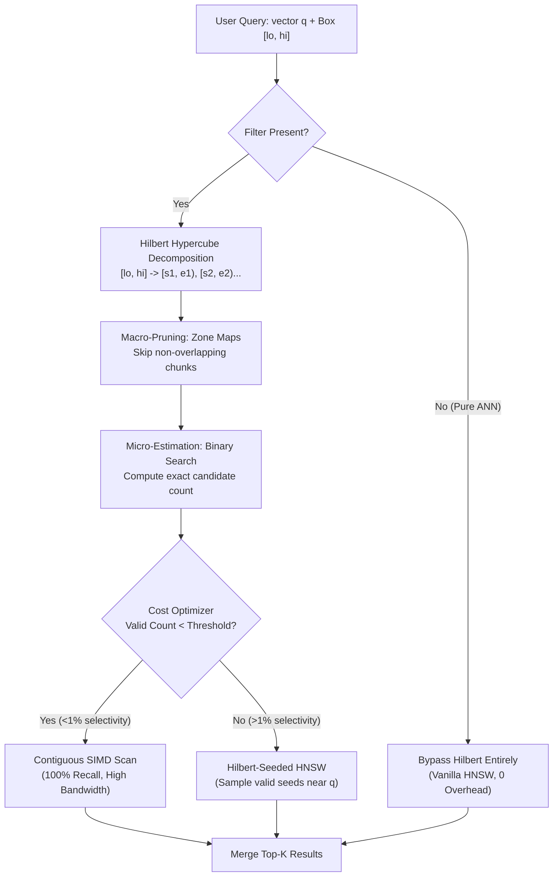
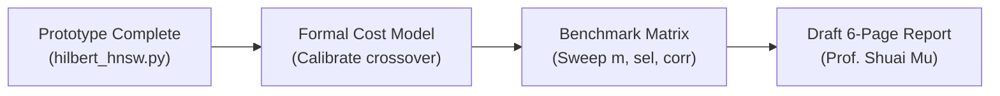

# Hilbert-Assisted Filtered ANN
## Bridging Multi-Attribute Filtering and High-Dimensional Vector Search

**Course:** CSE532 Database Systems (Graduate), Stony Brook University  
**Team:** Lawrence Caradonna, Arnav Desai  
**Instructor:** Prof. Shuai Mu  

---

<!-- slide -->

# Slide 1: Title & Executive Summary

### Problem
Modern vector databases struggle when queries combine high-dimensional similarity search with multi-attribute scalar constraints (e.g., $d=128$ embedding with `price BETWEEN 20 AND 50 AND rating >= 4.5`).

### Proposed Solution
Use a **space-filling Hilbert curve** over low-dimensional scalar attribute space ($m \le 4$) to augment a Hierarchical Navigable Small World (HNSW) vector index.

```
┌────────────────────────────────────────────────────────────────────────┐
│                        CORE ARCHITECTURAL ROLES                        │
├────────────────────────────────┬───────────────────────────────────────┤
│ 1. Zero-Cost Selectivity Est.  │ O(#intervals * log N) via sorted keys │
│ 2. Exact Chunk-Level Skipping  │ Zone Maps [min, max] prune cold files │
│ 3. Instant Scan Path           │ Contiguous SIMD scans for sel < 1%    │
│ 4. Valid Seed Placement        │ Parachutes graph traversal into valid │
│                                │ neighborhoods without disconnections  │
└────────────────────────────────┴───────────────────────────────────────┘
```

> [!NOTE]
> **Key Thesis:** Rather than attempting to map high-dimensional embeddings to 1D curves (which fails), we use the Hilbert curve solely for **multi-attribute scalar indexing and graph navigation assistance**.

---

<!-- slide -->

# Slide 2: The Filtered Vector Search Dilemma

Vector databases face a trilemma across the selectivity spectrum ($s = |V_{\text{valid}}| / N$):

```
0%                  1%                             20%                 100%
├───────────────────┼──────────────────────────────┼─────────────────────┤
│  High Selectivity │      Mid-Selectivity Gap     │   Low Selectivity   │
│  (Very few match) │   (Both approaches struggle) │   (Broad matches)   │
```

### Traditional Failure Modes

1. **Pre-Filtering (Filter $\to$ Vector Search):**
   * Computes matching IDs first, then restricts search to the filtered subgraph.
   * **Failure:** In HNSW, pruning invalid nodes breaks graph connectivity. The greedy walk gets trapped in local dead-ends, causing recall collapse.
2. **Post-Filtering (Vector Search $\to$ Filter):**
   * Traverses unconstrained HNSW to retrieve candidates, then discards non-matching vectors.
   * **Failure:** If selectivity $s = 0.5\%$, finding $k=10$ valid results requires exploring $\approx k/s = 2,000$ candidates. For strict filters, search returns $<k$ items.
3. **The Multi-Attribute Index Intersection Bottleneck:**
   * Traditional databases evaluate independent 1D B-Trees and compute expensive bitmap intersections (`AND`ing Roaring Bitmaps), adding latency before vector search even starts.

---

<!-- slide -->

# Slide 3: Proposed System Architecture



* **Decoupled Responsibilities:** Scalar range logic is handled by interval algebra; vector similarity is handled by graph traversal or SIMD dot products.
* **Graceful Degradation:** When filters are absent, the engine falls back to standard HNSW with zero penalty.

---

<!-- slide -->

# Slide 4: Key Mechanism 1 — Range Decomposition & Estimation

### Hypercube Decomposition
A query bounding box $[lo, hi]$ across $m$ attribute dimensions decomposes into a set of dyadic cubes along the Hilbert curve. Each aligned cube forms a single contiguous 1D key interval $[s_i, e_i)$.

$$\text{Decompose}([lo, hi], \text{depth}) \longrightarrow \bigcup_{i=1}^{K} [s_i, e_i)$$

```
Attribute Space (2D)                    Hilbert Curve (1D Key Space)
┌───────┬───────┐                       0──1   6──7   8──9   14──15
│ (0,1) │ (1,1) │                       │  │   │  │   │  │   │   │
│   2   │   3   │                       3──2   5──4   11─10  12──13
├───────┼───────┤                          └───┘         └───┘
│ (0,0) │ (1,0) │                       Intervals: [2, 6), [10, 14)
│   0   │   1   │                       Binary search on sorted keys
└───────┴───────┘
```

### Cardinality Estimation in $O(K \log N)$
* Binary search (`np.searchsorted`) on sorted Hilbert keys (`skeys`) gives exact or over-approximated candidate counts in microseconds.
* **Advantage over R-Trees / Histograms:** No separate statistical models or multi-dimensional kernel density estimators (KDE) required—the index *is* the histogram.
* **Advantage over 1D B-Trees:** A single decomposition resolves arbitrary multi-dimensional bounding boxes without multi-index bitmap intersections.

---

<!-- slide -->

# Slide 5: Key Mechanism 2 — Seed Placement & Graph Traversal

### The Entry-Point Cold-Start Problem
In filtered HNSW (like ACORN), standard top-layer entry points descend to nodes that may be invalid or far from the target valid cluster. The search must wander through invalid terrain to find valid clusters.

### Hilbert-Seeded Traversal
Instead of starting blindly from the global entry point:
1. Extract candidate IDs from matching Hilbert slices.
2. Sample a small seed budget ($B \approx \min(32, |V_{\text{valid}}|)$).
3. Score candidates against query $q$ and select the top $N_{\text{seeds}}$ valid points closest to $q$.
4. **Parachute** layer-0 beam search directly into the highest-quality valid neighborhood.

```
       [Global Entry Point] (Invalid)
                 │
                 ▼  (Blind walk through invalid nodes)
           [ ? ]   [ ? ]
                 │
                 ▼
═════════════════════════════════════════════════════════════════
   HILBERT SEEDING: Jump directly to valid nodes near q!
                 ▼
        (Valid Seed 1) ──> (Valid Seed 2) ──> [Target Top-K]
═════════════════════════════════════════════════════════════════
```

### Traversal Modes
* `_beam0` (Navigational): Invalid nodes are traversed for connectivity, but never added to result set.
* `_beam0_valid` (ACORN-Style 2-Hop): Evaluates distances only for valid nodes, hopping over invalid neighbors.

---

<!-- slide -->

# Slide 6: Systems Architecture — Frozen Chunks & Zone Maps

### The Storage Dilemma: Why Not Dynamic Re-Sorting?
Single-row inserts cannot be appended to flat sorted arrays without $O(N)$ array shifts. Furthermore, merging HNSW graphs during LSM compaction is computationally prohibitive ($O(N \cdot M \log N \cdot d)$ floating-point distance calculations).

### The Lakehouse Solution: Segmented / Frozen Chunks
Adopt the standard columnar vector lakehouse pattern (LanceDB / Milvus / ClickHouse):

```
┌────────────────────────────────────────────────────────┐
│                   FROZEN CHUNK (e.g. 200k vectors)     │
├────────────────────────────────────────────────────────┤
│ Header: Zone Map [min_key, max_key] (16 bytes)         │
│ Payload: Vectors X (Row or Columnar)                   │
│ Local Hilbert Index: sorted skeys + order array        │
│ Local HNSW Graph: frozen proximity graph               │
└────────────────────────────────────────────────────────┘
```

1. **Chunk-Level Pruning (Macro):** Check query Hilbert intervals against each chunk's Zone Map $[min\_key, max\_key]$. Non-overlapping chunks are skipped instantly with zero I/O or vector math.
2. **Per-Chunk Plan Selection (Micro):** Surviving chunks independently decide whether to execute a flat SIMD scan or a Hilbert-seeded graph search.
3. **No Graph Merges:** Chunks remain immutable. New writes enter an append buffer or new chunk.

---

<!-- slide -->

# Slide 7: Core Strengths & Advantages

### 1. Superior High-Selectivity Performance (<1%)
* When $<1\%$ of data matches, graph traversal overhead is completely bypassed.
* Contiguous Hilbert slices allow streaming, cache-aligned vector scans utilizing AVX-512 / ARM Neon SIMD vectorization.
* Guarantees **100% recall** where post-filtering starves.

### 2. Native Multi-Attribute Correlation
* Resolves joint range queries (e.g., `lat`, `lon`, `timestamp`, `price`) in a single pass.
* Eliminates the CPU and memory overhead of intersecting independent bitmaps.

### 3. Lightweight Index Footprint
* Auxiliary Hilbert structures (`skeys`, `order`, `Aq`) require only **16–20 bytes per vector**.
* Adds **$<3\%$ memory overhead** over baseline HNSW graph edges and raw vectors.

### 4. Zero Cold-Start Trapping
* Hilbert entry seeding eliminates graph disconnections for correlated attributes, allowing ACORN-style filtered traversals to converge with much smaller $ef$ search bounds.

---

<!-- slide -->

# Slide 8: Critical Weaknesses & Failure Modes

> [!WARNING]
> Understanding the failure modes is essential for defining the operational boundaries of this architecture.

### 1. The Curse of Attribute Dimensionality ($m > 4$)
* Hypercube decomposition exhibits $O(2^m)$ branching.
* For $m \ge 6$, decomposing a query yields thousands of disjoint 1D intervals.
* **Consequence:** Interval decomposition time exceeds vector search time, and contiguous scanning degenerates into random seeks.

### 2. The Unconstrained Dimension Trap ("Hyper-Slabs")
* If the curve indexes $(x, y, z)$, but a query only filters on $x$ (`x > 50`), the query represents an infinite geometric slab across $y$ and $z$.
* Slicing an unconstrained slab across a Hilbert curve shatters into an immense number of tiny intervals, destroying locality.

### 3. Seed Over-Budgeting Overhead
* Scoring $B$ seed candidates requires $B$ exact vector distance computations.
* If $B=512$ while HNSW traversal needs only $200$ distance checks, the "seed preparation" step becomes a net performance loss.

### 4. Rigid Index Schema
* Attributes must be fixed at index build time. Dynamic queries on unindexed columns require fallback filtering.

---

<!-- slide -->

# Slide 9: Experimental Evaluation Plan

To evaluate Hilbert-HNSW rigorously for CSE532, we conduct empirical sweeps across four axes:

```
                      EVALUATION MATRIX
┌───────────────────────┬────────────────────────────────────────────┐
│ Sweep Axis            │ Values / Configurations                    │
├───────────────────────┼────────────────────────────────────────────┤
│ 1. Predicate Sel.     │ 0.1%, 0.5%, 1%, 5%, 10%, 25%, 50%          │
│ 2. Attribute Dim. (m) │ m ∈ {1, 2, 3, 4, 6}                        │
│ 3. Data Correlation   │ Independent Uniform vs. Correlated Embed.  │
│ 4. Seed Budget (B)    │ B ∈ {0, 8, 32, 64, 128, 512}               │
└───────────────────────┴────────────────────────────────────────────┘
```

### Key Metrics to Report
1. **Recall@10 vs. Distance Computations (`ndis`):** Pareto frontier of search efficiency.
2. **Selectivity Estimator Accuracy (q-error):**
   $$\text{q-error} = \max\left(\frac{\hat{N}}{N}, \frac{N}{\hat{N}}\right)$$
   Measures estimation fidelity across `max_depth` settings.
3. **Decomposition Overhead vs. Query Latency:** Demonstrating the crossover point where high $m$ degrades performance.
4. **Baselines:** Plain Post-Filtered HNSW, Pure Flat Scan, and ACORN-1 traversal.

---

<!-- slide -->

# Slide 10: Conclusion & Project Roadmap

### Takeaway
Hilbert-Assisted Filtered HNSW is **not a replacement for all general-purpose vector filtering**, but it is a **highly potent physical layout and entry-seeding engine** for:
* Low-to-medium continuous attribute dimensions ($m \le 4$).
* Spatio-temporal and sensor workloads (e.g., geospatial coordinates + time).
* High-selectivity regimes where traditional graph traversal fails.

### CSE532 Technical Report Roadmap



* **Immediate Next Step:** Calibrate the dynamic cost model threshold ($\text{Cost}_{\text{scan}}$ vs $\text{Cost}_{\text{graph}}$) and benchmark the dimensionality ceiling on synthetic & real datasets.

---
