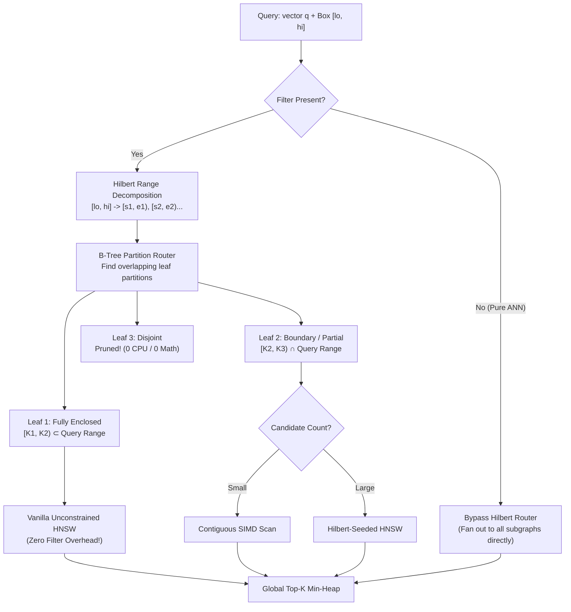
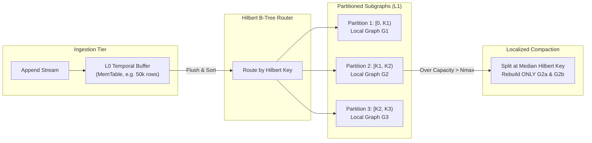
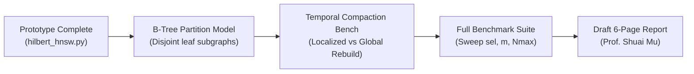

# Hilbert-Assisted Filtered ANN
## Bridging Multi-Attribute Filtering and High-Dimensional Vector Search

**Course:** CSE532 Database Systems (Graduate), Stony Brook University  
**Team:** Lawrence Caradonna, Arnav Desai  
**Instructor:** Prof. Shuai Mu  

---

<!-- slide -->

# Slide 1: Title & Executive Summary

### Problem
Modern vector databases struggle when queries combine high-dimensional similarity search with multi-attribute scalar constraints (e.g., $d=128$ embedding with `price BETWEEN 20 AND 50 AND rating >= 4.5`).

### Proposed Solution
A **Hilbert-Partitioned B-Tree of Subgraphs** paired with a **Temporal Merging Scheme**:
* Low-dimensional attributes ($m \le 4$) are linearized into a 1D Hilbert key space.
* Physical data is partitioned into a B-Tree where leaf nodes cover disjoint Hilbert intervals $[K_i, K_{i+1})$ hosting dedicated, independent HNSW subgraphs.
* A temporal LSM-style buffer ingests stream appends and flushes localized delta batches without requiring global graph rewiring.

```
┌────────────────────────────────────────────────────────────────────────┐
│                        CORE ARCHITECTURAL ROLES                        │
├────────────────────────────────┬───────────────────────────────────────┤
│ 1. Zero-Cost Selectivity Est.  │ O(#intervals * log N) via sorted keys │
│ 2. Disjoint Chunk Pruning      │ B-Tree bounds prune non-overlapping   │
│ 3. Zero-Filter Subgraph Search │ 100% vanilla HNSW on enclosed leaves  │
│ 4. Localized Temporal Merge    │ Graph rebuilds bounded to single leaf │
└────────────────────────────────┴───────────────────────────────────────┘
```

> [!NOTE]
> **Key Thesis:** By partitioning data into a Hilbert B-Tree of independent subgraphs, we eliminate the catastrophic global graph-merge bottleneck of LSM vector stores and achieve zero-filtering overhead on fully enclosed partitions.

---

<!-- slide -->

# Slide 2: The Filtered Vector Search Dilemma

Vector databases face a trilemma across the selectivity spectrum ($s = |V_{\text{valid}}| / N$):

```
0%                  1%                             20%                 100%
├───────────────────┼──────────────────────────────┼─────────────────────┤
│  High Selectivity │      Mid-Selectivity Gap     │   Low Selectivity   │
│  (Very few match) │   (Both approaches struggle) │   (Broad matches)   │
```

### Traditional Failure Modes

1. **Pre-Filtering (Filter $\to$ Vector Search):**
   * Computes matching IDs first, then restricts search to the filtered subgraph.
   * **Failure:** In HNSW, pruning invalid nodes breaks graph connectivity. The greedy walk gets trapped in local dead-ends, causing recall collapse.
2. **Post-Filtering (Vector Search $\to$ Filter):**
   * Traverses unconstrained HNSW to retrieve candidates, then discards non-matching vectors.
   * **Failure:** If selectivity $s = 0.5\%$, finding $k=10$ valid results requires exploring $\approx k/s = 2,000$ candidates. For strict filters, search returns $<k$ items.
3. **The Multi-Attribute Index Intersection Bottleneck:**
   * Traditional databases evaluate independent 1D B-Trees and compute expensive bitmap intersections (`AND`ing Roaring Bitmaps), adding latency before vector search even starts.

---

<!-- slide -->

# Slide 3: Proposed System Architecture



* **Decoupled Responsibilities:** Scalar ranges routed by B-Tree interval algebra; vector search localized to dedicated subgraphs.
* **Graceful Degradation:** When filters are absent, all subgraphs execute vanilla HNSW with zero penalty.

---

<!-- slide -->

# Slide 4: Key Mechanism 1 — Range Decomposition & Estimation

### Hypercube Decomposition
A query bounding box $[lo, hi]$ across $m$ attribute dimensions decomposes into a set of dyadic cubes along the Hilbert curve. Each aligned cube forms a single contiguous 1D key interval $[s_i, e_i)$.

$$\text{Decompose}([lo, hi], \text{depth}) \longrightarrow \bigcup_{i=1}^{K} [s_i, e_i)$$

```
Attribute Space (2D)                    Hilbert Curve (1D Key Space)
┌───────┬───────┐                       0──1   6──7   8──9   14──15
│ (0,1) │ (1,1) │                       │  │   │  │   │  │   │   │
│   2   │   3   │                       3──2   5──4   11─10  12──13
├───────┼───────┤                          └───┘         └───┘
│ (0,0) │ (1,0) │                       Intervals: [2, 6), [10, 14)
│   0   │   1   │                       Binary search on sorted keys
└───────┴───────┘
```

### Cardinality Estimation in $O(K \log N)$
* Binary search (`np.searchsorted`) on sorted Hilbert keys (`skeys`) gives exact or over-approximated candidate counts in microseconds.
* **Advantage over R-Trees / Histograms:** No separate statistical models or multi-dimensional kernel density estimators (KDE) required—the index *is* the histogram.
* **Advantage over 1D B-Trees:** A single decomposition resolves arbitrary multi-dimensional bounding boxes without multi-index bitmap intersections.

---

<!-- slide -->

# Slide 5: Key Mechanism 2 — Seed Placement & Graph Traversal

### The Entry-Point Cold-Start Problem
In filtered HNSW (like ACORN), standard top-layer entry points descend to nodes that may be invalid or far from the target valid cluster. The search must wander through invalid terrain to find valid clusters.

### Hilbert-Seeded Traversal (For Boundary Partitions)
For partitions that partially overlap the query range:
1. Extract candidate IDs from matching Hilbert slices.
2. Sample a small seed budget ($B \approx \min(32, |V_{\text{valid}}|)$).
3. Score candidates against query $q$ and select the top $N_{\text{seeds}}$ valid points closest to $q$.
4. **Parachute** layer-0 beam search directly into the highest-quality valid neighborhood.

```
       [Global Entry Point] (Invalid)
                 │
                 ▼  (Blind walk through invalid nodes)
           [ ? ]   [ ? ]
                 │
                 ▼
═════════════════════════════════════════════════════════════════
   HILBERT SEEDING: Jump directly to valid nodes near q!
                 ▼
        (Valid Seed 1) ──> (Valid Seed 2) ──> [Target Top-K]
═════════════════════════════════════════════════════════════════
```

### Traversal Modes
* `_beam0` (Navigational): Invalid nodes are traversed for connectivity, but never added to result set.
* `_beam0_valid` (ACORN-Style 2-Hop): Evaluates distances only for valid nodes, hopping over invalid neighbors.

---

<!-- slide -->

# Slide 6: Systems Architecture — Hilbert B-Tree & Temporal Merging



### The Ingestion & Compaction Lifecycle

1. **L0 Temporal Buffering:** Incoming appends land in an active in-memory buffer. Unfiltered searches scan L0 directly via SIMD.
2. **Hilbert-Partitioned Flushing:** When L0 fills, points are sorted by Hilbert key and dispatched into leaf partition buffers.
3. **The "Zero Cross-Graph Merge" Guarantee:**
   * Traditional vector LSM-stores must rewire edges across the entire dataset during compaction ($O(N \cdot M \log N \cdot d)$ floating-point distance math).
   * **Our approach:** Graph rebuilds are strictly **contained within a single leaf**. Partitions are permanently disjoint in Hilbert space; cross-partition graph rewiring is **never** required.
4. **Dynamic Median Splitting:** When leaf size exceeds $N_{\max}$ (e.g. 50k), it splits into two leaves along the median Hilbert key, balancing data skew.

---

<!-- slide -->

# Slide 7: Core Strengths & Advantages

### 1. Zero Filter Overhead on Fully Enclosed Leaves
* When a query interval completely spans a leaf's Hilbert bounds $[K_i, K_{i+1})$, **100% of the vectors in that leaf are valid**.
* Traversal runs as **pure, unconstrained vanilla HNSW**—no ACORN hopping, no bitmask checks, no graph disconnection penalties.

### 2. High-Selectivity Acceleration (<1%)
* When $<1\%$ of data matches, graph traversal overhead is completely bypassed.
* Contiguous Hilbert slices allow streaming, cache-aligned vector scans utilizing AVX-512 / ARM Neon SIMD vectorization.
* Guarantees **100% recall** where post-filtering starves.

### 3. Lightweight Index Footprint
* Auxiliary Hilbert structures (`skeys`, `order`, `Aq`) require only **16–20 bytes per vector**.
* Adds **$<3\%$ memory overhead** over baseline HNSW graph edges and raw vectors.

### 4. Non-Blocking Localized Maintenance
* Stream appends and compaction tasks only lock or rebuild the single target leaf partition, keeping the rest of the database online and low-latency.

---

<!-- slide -->

# Slide 8: Critical Weaknesses & Systems Trade-Offs

> [!WARNING]
> Understanding the failure modes is essential for defining the operational boundaries of this architecture.

### 1. Scatter-Gather Penalty on Broad Queries
* For broad queries (e.g. 50% selectivity or unconstrained pure ANN), the query intersects many leaf partitions.
* Searching 20 small subgraphs of size $N/20$ incurs 20 separate entry-point descents, which can exceed the cost of searching a single unified graph of size $N$.

### 2. The Curse of Attribute Dimensionality ($m > 4$)
* Hypercube decomposition exhibits $O(2^m)$ branching.
* For $m \ge 6$, decomposing a query yields thousands of disjoint 1D intervals.
* **Mitigation:** Use an ensemble of low-dimensional subspace curves (e.g. separate 2D curves for spatial and commercial attributes).

### 3. The Unconstrained Dimension Trap ("Hyper-Slabs")
* If the curve indexes $(x, y, z)$, but a query only filters on $x$ (`x > 50`), the query represents an infinite geometric slab across $y$ and $z$, shattering into many small intervals.

### 4. Attribute Partitioning vs. Semantic Locality
* Two identical vectors with slightly different attributes (e.g. price \$49.99 vs \$50.01) fall into different partition subgraphs, precluding direct graph edge connectivity between them.

---

<!-- slide -->

# Slide 9: Experimental Evaluation Plan

To evaluate Hilbert-HNSW rigorously for CSE532, we conduct empirical sweeps across five axes:

```
                      EVALUATION MATRIX
┌───────────────────────┬────────────────────────────────────────────┐
│ Sweep Axis            │ Values / Configurations                    │
├───────────────────────┼────────────────────────────────────────────┤
│ 1. Predicate Sel.     │ 0.1%, 0.5%, 1%, 5%, 10%, 25%, 50%          │
│ 2. Attribute Dim. (m) │ m ∈ {1, 2, 3, 4, 6}                        │
│ 3. Data Correlation   │ Independent Uniform vs. Correlated Embed.  │
│ 4. Leaf Capacity Nmax │ 5k, 10k, 25k, 50k vectors per subgraph     │
│ 5. Compaction Latency │ Localized Leaf Rebuild vs. Global Rebuild  │
└───────────────────────┴────────────────────────────────────────────┘
```

### Key Metrics to Report
1. **Recall@10 vs. Distance Computations (`ndis`):** Pareto frontier of search efficiency.
2. **Compaction Throughput (Vectors/sec):** Measuring time to ingest and compact streaming appends under localized vs. global graph maintenance.
3. **Selectivity Estimator Accuracy (q-error):**
   $$\text{q-error} = \max\left(\frac{\hat{N}}{N}, \frac{N}{\hat{N}}\right)$$
4. **Baselines:** Plain Post-Filtered HNSW, Pure Flat Scan, and ACORN-1 traversal.

---

<!-- slide -->

# Slide 10: Conclusion & Project Roadmap

### Takeaway
A **Hilbert-Partitioned B-Tree of Subgraphs with Temporal Merging** addresses the two biggest pain points in modern vector systems:
1. **At Query Time:** Eliminates the mid-selectivity filtered HNSW crash by converting fully enclosed ranges into vanilla unconstrained graph searches.
2. **At Ingestion Time:** Replaces the intractable $O(N \log N \cdot d)$ global graph merge with bounded, localized leaf compaction.

### CSE532 Technical Report Roadmap



* **Immediate Next Step:** Benchmark the crossover point where partitioned multi-subgraph search outperforms a single unified graph across the selectivity spectrum.

---
